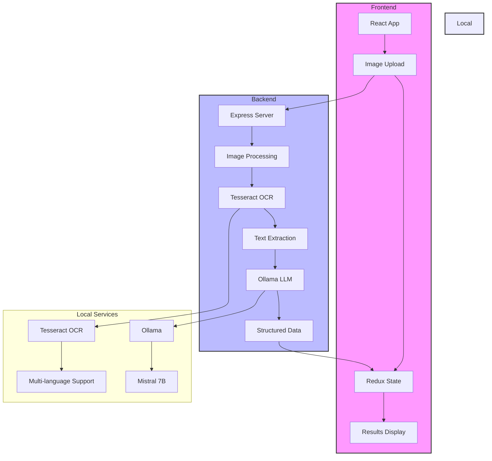

# AI KYC OCR ID Validator

> AI-powered offline KYC document extraction and matching using Tesseract OCR and local LLMs via Ollama.

[](LICENSE)
[](https://ollama.ai/library/mistral)
[](https://github.com/tesseract-ocr/tesseract)
[](https://developer.apple.com/metal/)
[](SECURITY.md)
[](https://www.docker.com/)

## Features

- 📤 Upload scanned ID card images (JPEG/PNG)
- 🧠 Tesseract OCR with multi-language support (`bul+eng`)
- 🤖 Mistral 7B via Ollama for structured KYC field extraction
- ✅ JSON output with full name, DOB, nationality, document number
- 📊 Match percentage scoring against expected profiles
- 💻 Local processing — no cloud dependencies
- 🐳 Docker Compose support for frontend/backend services

## Preview


## System Architecture



### Flow Description

1. **Frontend Layer**
   - User uploads ID image through React interface
   - Redux manages application state
   - Results displayed with match scoring

2. **Backend Layer**
   - Express server handles requests
   - Image processing and OCR extraction
   - LLM analysis for structured data

3. **Local Services**
   - Tesseract OCR for text extraction
   - Ollama running Mistral 7B for data structuring

## Project Structure

```
ai-kyc-ocr-id-validator/
├── kyc-ocr-frontend/       # React + Tailwind CSS
├── kyc-ocr-backend/        # Node.js + Express + OCR + LLM
├── docs/                   # Architecture, prompts, benchmarks
├── .github/                # Issue and PR templates
├── docker-compose.yml
├── Makefile
└── README.md
```

## Prerequisites

- Node.js 18+
- Tesseract OCR
- Ollama with Mistral model
- Docker and Docker Compose

## Quick Start

1. Pull the Mistral model:
```bash
ollama pull mistral
```

2. Start the application:
```bash
docker-compose up
```

3. Access the services:
- Frontend: http://localhost:5173
- Backend: http://localhost:5000

## Development

- Source code changes are automatically reflected via volume mounting
- Rebuild containers after dependency changes:
```bash
docker-compose up --build
```

## Contributing

Please read [CONTRIBUTING.md](CONTRIBUTING.md) for details on our code of conduct and the process for submitting pull requests.

## License

This project is licensed under the MIT License - see the [LICENSE](LICENSE) file for details.

## Security

For security concerns, please read our [SECURITY.md](SECURITY.md) document.

